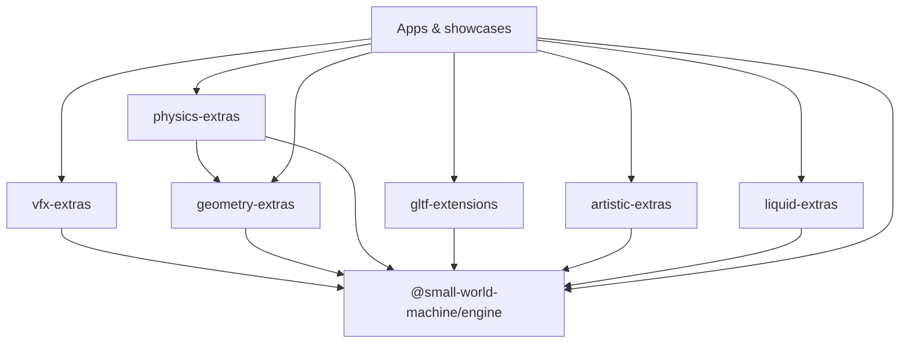

# Extensions & Ecosystem

`@small-world-machine/engine` is the core package; domain-specific functionality lives in optional ecosystem packages that depend on it. See [ADR 0014](/adr/0014-modular-ecosystem-and-domain-layering), [ADR 0018](/adr/0018-gltf-data-level-extensions-and-ecosystem-package), [ADR 0021](/adr/0021-ecosystem-packages-exotic-geometry-and-physics), [ADR 0022](/adr/0022-gpu-instanced-vfx-pipeline-and-extras-package), [ADR 0025](/adr/0025-stylized-liquid-looks-engine-vs-extension) and [ADR 0042](/adr/0042-drop-impact-system).

The core contains math, scene graph, cameras, renderers, passes, standard shaders, core primitives and base collision. Everything else is an ecosystem package in the npm workspace (`packages/*`). The packages are not published to npm.

## Packages

| Package | Directory | Contents |
|---|---|---|
| [`@small-world-machine/vfx-extras`](./vfx-extras.md) | `packages/vfx-extras/` | GPU-instanced particle systems, `ParticleMeshRenderer`, 10 affectors, `AccretionDiskEmitter` |
| [`@small-world-machine/geometry-extras`](./geometry-extras.md) | `packages/geometry-extras/` | Procedural and parametric geometries: supershape, torus knot, Möbius strip, lathe, Platonic solids, parametric surface, filled polygon, Voronoi cells, marching cubes |
| [`@small-world-machine/physics-extras`](./physics-extras.md) | `packages/physics-extras/` | Voronoi fracture with convex colliders (`fractureObject`) |
| [`@small-world-machine/gltf-extensions`](./gltf-extensions.md) | `packages/gltf-extensions/` | glTF 2.0 extensions `KHR_draco_mesh_compression` and `KHR_texture_basisu` |
| [`@small-world-machine/artistic-extras`](./artistic-extras.md) | `packages/artistic-extras/` | Metal relief and impasto materials, relief post-processor, color utilities |
| [`@small-world-machine/liquid-extras`](./liquid-extras.md) | `packages/liquid-extras/` | Noir water, oil and rain puddle materials, `DropImpactSystem`, thin-film shading |
| [`@small-world-machine/tools`](/guides/toolchain) | `packages/tools/` | Maker, Material Studio, Pixler, Xtractor, Map Generator, Forge; see [ADR 0024](/adr/0024-tools-ecosystem-package) |

## Dependencies

Rules:

1. Ecosystem packages depend on the engine; the engine never depends on them.
2. Packages may depend on each other (`physics-extras` uses `geometry-extras`) as long as no cycle arises.
3. An app imports only the packages it uses.
